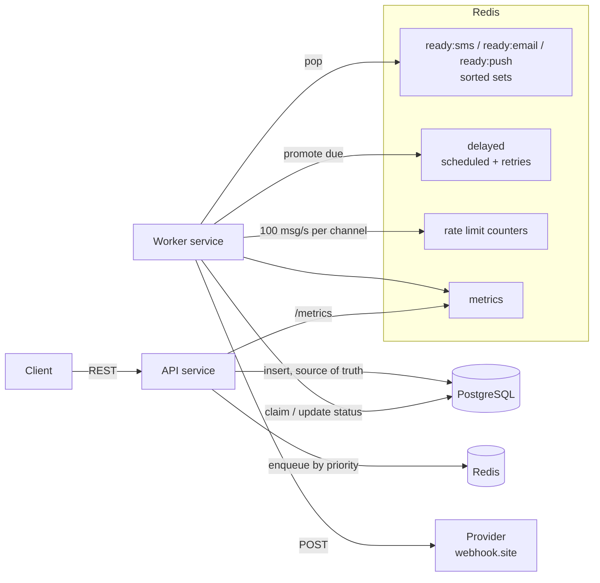

# Event-Driven Notification System

A scalable notification service written in Go that accepts SMS, Email and Push
notifications over a REST API, queues them by priority, and delivers them
asynchronously through an external provider with per-channel rate limiting,
retries with exponential backoff, and real-time observability.

## Quick start

```bash
# Optional: point the workers at your own webhook.site URL
echo "PROVIDER_URL=https://webhook.site/<your-uuid>" > .env

docker compose up --build
```

| URL | What |
| --- | --- |
| http://localhost:8080/docs | Swagger UI |
| http://localhost:8080/openapi.yaml | OpenAPI 3 spec |
| http://localhost:8080/health | Health check (PostgreSQL + Redis) |
| http://localhost:8080/metrics | Queue depth, success/failure rates, latency |

Configure webhook.site to respond with status **202** and body
`{"messageId": "$request.uuid$", "status": "accepted", "timestamp": "$request.date$"}`.

## Architecture



Two binaries share one codebase so they scale independently:

* **`cmd/api`** validates requests, stores notifications in PostgreSQL, and
  pushes their IDs onto Redis queues. It also serves `/health`, `/metrics` and
  the Swagger docs.
* **`cmd/worker`** runs `WORKER_COUNT` consumers per channel, plus a promoter
  (moves due scheduled/retry items to ready queues) and a reconciler
  (re-queues anything PostgreSQL says is due but Redis lost).

### Notification lifecycle

```
pending ──claim──▶ processing ──202──▶ sent
   ▲                   │
   │   retryable error │ (5xx, 429, timeout, network)
   └──── backoff ◀─────┤
                       │ permanent error (4xx) or max attempts
                       ▼
                     failed
scheduled ──due──▶ pending          pending/scheduled ──cancel──▶ cancelled
```

### Key design decisions

**PostgreSQL is the source of truth, Redis is the transport.** Every
notification is committed to PostgreSQL before it is queued. If Redis is down
or an enqueue is lost, the reconciler finds due rows and re-queues them, so no
accepted notification is dropped.

**Priority queue.** Each channel has a Redis sorted set whose score is
`rank × 10¹³ + enqueuedAtMillis` (high = 0, normal = 1, low = 2). `ZPOPMIN`
therefore returns strict priority order with FIFO inside each priority.
Retries keep their original priority.

**Rate limiting: 100 msg/s per channel.** A fixed one-second window counter in
Redis (atomic Lua `INCR` + `PEXPIRE`), shared by every worker process, so the
limit holds no matter how many workers are running. Load test: 3,000 SMS were
sent at a steady ~100 attempts per second.

**Idempotency, at two levels.**
1. *API:* an `Idempotency-Key` header (or `idempotencyKey` per batch item) is
   enforced by a partial unique index. Repeating a request returns the original
   notification with `200` instead of creating a duplicate.
2. *Delivery:* workers move a row to `processing` with a conditional `UPDATE … WHERE status IN ('pending','scheduled')`.
   Only one worker can win, so duplicate queue entries, cancelled
   notifications and already-sent notifications are never sent again. The
   notification ID is also sent to the provider as an `Idempotency-Key`
   header, so a provider that de-duplicates can absorb the rare resend after a
   worker crash.

**Retries.** Exponential backoff `2s × 2^(attempt-1)` with ±20% jitter (to
avoid thundering herds after an outage), capped at 5 minutes, up to
`MAX_ATTEMPTS` (default 5). Only transient errors (network, timeout, 429, 5xx)
are retried; 4xx responses fail immediately. Failed notifications keep their
`lastError` and can be listed with `?status=failed` (they act as the
dead-letter queue).

**Crash recovery.** In-flight sends finish on shutdown (`SIGTERM`). If a
worker dies mid-send, the reconciler resets rows stuck in `processing` for
more than 60 s and re-queues them.

**Observability.** JSON structured logs via `log/slog`. Every request gets an
`X-Correlation-ID` (taken from the client or generated). It is stored on the
notification, so worker logs and the provider request carry the same ID as
the original API call.

## API examples

Create a notification:

```bash
curl -X POST localhost:8080/api/v1/notifications \
  -H 'Content-Type: application/json' \
  -H 'Idempotency-Key: order-1234-shipped' \
  -d '{"recipient":"+905551234567","channel":"sms","content":"Your order has shipped!","priority":"high"}'
```

Schedule one for later:

```bash
curl -X POST localhost:8080/api/v1/notifications \
  -d '{"recipient":"user@example.com","channel":"email","content":"Flash sale starts now!","scheduledAt":"2030-01-01T09:00:00Z"}'
```

Create a batch (up to 1000, validated all-or-nothing):

```bash
curl -X POST localhost:8080/api/v1/notifications/batch -d '{
  "notifications": [
    {"recipient":"+905551234567","channel":"sms","content":"Hi"},
    {"recipient":"device-token-abc","channel":"push","content":"Breaking news","priority":"high"}
  ]}'
```

Query, list and cancel:

```bash
curl localhost:8080/api/v1/notifications/{id}
curl localhost:8080/api/v1/batches/{batchId}
curl 'localhost:8080/api/v1/notifications?status=failed&channel=sms&from=2026-01-01T00:00:00Z&limit=20&offset=0'
curl -X POST localhost:8080/api/v1/notifications/{id}/cancel
```

Validation errors return `422` with per-field details:

```json
{"error":"validation failed","details":{"content":"exceeds 160 characters for sms (got 171)"}}
```

| Channel | Recipient format | Max content |
| --- | --- | --- |
| sms | E.164 (`+905551234567`) | 160 characters |
| push | device token | 256 characters |
| email | email address | 10,000 characters |

## Configuration

| Variable | Default | Description |
| --- | --- | --- |
| `PROVIDER_URL` | `https://webhook.site/your-uuid` | Provider endpoint |
| `PROVIDER_TIMEOUT` | `5s` | Per-request timeout |
| `RATE_LIMIT_PER_SEC` | `100` | Messages per second, per channel |
| `WORKER_COUNT` | `10` | Consumers per channel, per worker process |
| `MAX_ATTEMPTS` | `5` | Delivery attempts before marking failed |
| `DATABASE_URL` | local PostgreSQL | |
| `REDIS_ADDR` | `localhost:6379` | |
| `HTTP_ADDR` | `:8080` | API listen address |
| `LOG_LEVEL` | `info` | `debug`, `info`, `warn`, `error` |

## Tests

```bash
make test               # unit tests, no external dependencies (Redis is simulated with miniredis)
make test-integration   # also runs repository tests against PostgreSQL from docker compose
```

Covered: validation rules, idempotent create, batch validation, priority
ordering, delayed promotion, rate limit windows, provider error
classification, retry/backoff/give-up logic, skip-on-cancel, metrics
aggregation, and the SQL repository (idempotent insert, exclusive claim,
cancel rules, filters).

CI (GitHub Actions) runs gofmt, `go vet`, golangci-lint, the full test suite
against a PostgreSQL service container, and a Docker image build.

## Database migrations

Versioned SQL files live in [`migrations/`](migrations) and are embedded in the
binary. The API applies pending migrations on startup with
[golang-migrate](https://github.com/golang-migrate/migrate).

## Project layout

```
cmd/api            HTTP API entrypoint
cmd/worker         queue consumer entrypoint
api/               OpenAPI spec + Swagger UI
internal/notification  domain model, validation, repository, service, handlers
internal/queue     Redis priority + delayed queues
internal/worker    delivery loop, retries, reconciler
internal/provider  provider HTTP client
internal/ratelimit distributed per-channel limiter
internal/metrics   Redis-backed metrics + /metrics handler
internal/...       config, logging, health, http helpers, database
migrations/        versioned schema
```

## Trade-offs and next steps

* **Redis vs Kafka/RabbitMQ.** Redis sorted sets give priority, delay and
  dedup in one dependency, which fits this scope. At much higher volume a
  log-based broker (Kafka) with per-priority topics would give stronger
  durability and replay.
* **Offset pagination** is simple and supports `total`. For very large tables,
  keyset pagination on `(created_at, id)` (already indexed) would be faster.
* **Possible additions:** message templates, WebSocket status updates,
  OpenTelemetry tracing, Prometheus exposition format, per-tenant rate limits.
